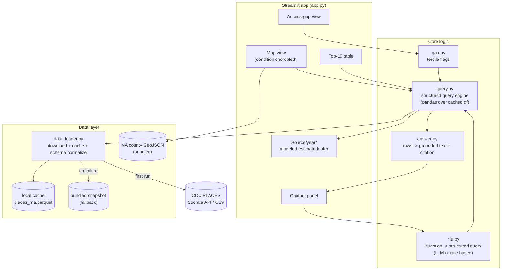
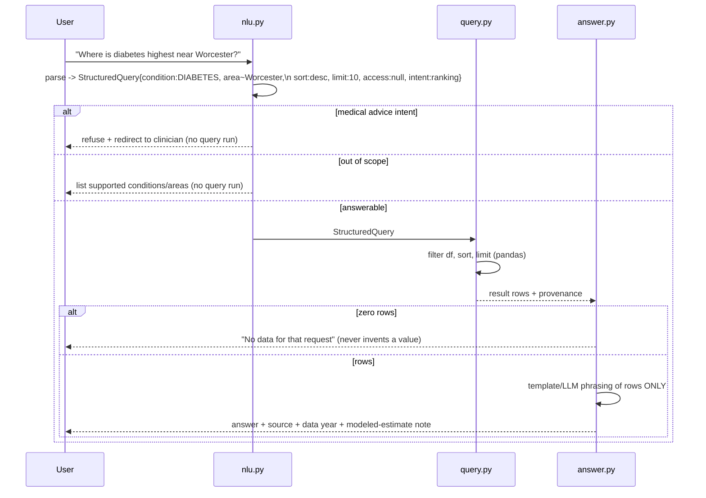

# Design — Condition Hotspot Finder

## Confirmed data facts (verified live against the Socrata API)

These were open questions; they are now settled and the build should treat them
as fixed.

- **Dataset:** CDC PLACES **County** data, **2025 release**, Socrata id
  **`swc5-untb`** on `data.cdc.gov`. Pin this; do not mix releases.
- **Geography:** **county only**, all **14 MA counties**, **zero missing/
  suppressed values** for the six measures. No suppression handling needed.
- **Data year:** **2023** for all six measures (DIABETES, CASTHMA, BPHIGH, COPD,
  ACCESS2, CHECKUP), confirmed via a grouped count query.
- **Measure IDs confirmed present for MA counties:** `DIABETES`, `CASTHMA`,
  `BPHIGH`, `COPD`, `ACCESS2`, `CHECKUP`. Filter on `measureid`, display
  `measure`.
- **Value type:** crude (`data_value_type = 'Crude prevalence'`).
- **Fetch shape:**
  ```
  GET https://data.cdc.gov/resource/swc5-untb.json
    ?$where=stateabbr='MA'
       AND measureid in('DIABETES','CASTHMA','BPHIGH','COPD','ACCESS2','CHECKUP')
       AND data_value_type='Crude prevalence'
    &$limit=5000
  ```
  Returns ~84 rows (6 measures × 14 counties). Loads instantly.
- **Column mapping (raw ↔ the "card" view):** `locationname`=County,
  `measure`=Measure, `data_value`=Percent, `low_confidence_limit`=Low,
  `high_confidence_limit`=High, `totalpopulation`=Population.
- **Observed value ranges (sanity baseline for DOM validation):**
  DIABETES 7–13%, BPHIGH ~25–35%, CASTHMA ~10–13%, COPD ~4–9%,
  ACCESS2 ~2–6%, CHECKUP ~75–84%.

## Open questions & assumptions (confirm in first 30 min)

Only these remain genuinely open; each has a safe default so no one blocks.

1. **Crude vs. age-adjusted prevalence.** *Default: crude.* Crude reflects the
   actual local population a clinic would screen. Keep it consistent across map,
   table, and chat.
2. **Access-gap thresholds.** *Default: terciles.* "High burden" = top third of
   counties for the condition; "low access" = bottom third for checkup OR top
   third for the uninsured gap (ACCESS2). With only 14 counties a tercile is ~5
   counties — state the exact rule in the UI. *(Risk: narrow county value spread
   can make tiers look arbitrary; show the actual values so the cut is legible.)*
3. **LLM provider.** *Default: provider-agnostic interface with a rule-based
   parser as the shipped fallback.* If a key is available, wire one hosted
   provider. The demo must pass with zero keys.
4. **Map rendering tech.** *Default: `pydeck` or `st.map` with a GeoJSON layer;
   fallback to a Plotly choropleth.* MA county GeoJSON (14 polygons) is tiny and
   bundled so maps work offline.
5. **County value spread is narrow** (e.g. CASTHMA ~10.5–12.9%). The choropleth
   can look washed out and "top 10 of 14" is a short ranking. *Default: keep
   county (matches the confirmed data slice); use a tight color-scale domain and
   show values on the map so differences read.* Town-level would widen the
   spread but is a different dataset and out of scope for this build.

### Timeline risks & what to cut first (cut from the bottom up)

1. **Cut first:** CSV download (R3.5), any demographic enrichment, age-adjusted toggle.
2. Hosted LLM wiring → ship rule-based parser only (still satisfies R5).
3. Fancy map interactions (click-to-filter) → hover tooltips only.
**Never cut:** offline cache + bundled snapshot (R1.3), modeled-estimate
disclosure (R6), medical-advice refusal (R5.5). These are correctness/safety,
not polish.

---

## Architecture



**Separation that matters for correctness:** the chatbot path is
`NLU -> QE -> ANS`. The LLM (or rule parser) only produces a *structured query*
and later *phrases* the result. All numbers come from `query.py` running over the
cached DataFrame. The LLM never emits a prevalence value. This is what makes R5
("not from model memory") true by construction.

---

## Data pipeline

1. **Source.** CDC PLACES County, 2025 release, `data.cdc.gov`, dataset
   `swc5-untb`. All six measures are BRFSS data year **2023**. Pin this dataset;
   do not mix releases.
2. **Fetch.** Socrata SoQL request filtered server-side to MA and our 6 measures:
   ```
   GET https://data.cdc.gov/resource/swc5-untb.json
     ?$where=stateabbr='MA'
        AND measureid in('DIABETES','CASTHMA','BPHIGH','COPD','ACCESS2','CHECKUP')
        AND data_value_type='Crude prevalence'
     &$limit=5000
     &$$app_token=<optional>
   ```
   Returns ~84 rows. CSV download of the same dataset is an equivalent fallback
   if the API is rate limited.
3. **Normalize** into one tidy table (schema below). Pivot is done on demand in
   `query.py`; cache stays long/tidy.
4. **Cache** to `data/places_ma.parquet` (or CSV). On startup, prefer cache →
   then live fetch → then bundled snapshot `data/snapshot_places_ma.csv`.
5. **Geometry.** Bundle `data/ma_counties.geojson` (14 county polygons) keyed by
   FIPS/`locationid` for map joins.
6. **Provenance record.** Persist `{source:"CDC PLACES", dataset_id:"swc5-untb",
   dataset_url, release_year:2025, data_year:2023, retrieved_at}` alongside the
   cache for R6.

---

## Data model / schema

Tidy long table, one row per geography × measure:

| column | type | notes |
|---|---|---|
| `locationid` | str | county FIPS (e.g. `25027`); join key to GeoJSON |
| `locationname` | str | county name, e.g. "Worcester" |
| `geo_level` | str | always `county` (this build) |
| `stateabbr` | str | always `MA` |
| `measureid` | str | `DIABETES` / `CASTHMA` / `BPHIGH` / `COPD` / `ACCESS2` / `CHECKUP` |
| `measure_label` | str | human label from `measure`, e.g. "Diagnosed diabetes among adults" |
| `measure_kind` | str | `condition` or `access` |
| `data_value` | float | prevalence %, the primary number |
| `data_value_type` | str | `Crude prevalence` |
| `low_ci`, `high_ci` | float | 95% CI bounds (display only) |
| `total_population` | int | from PLACES `totalpopulation` |
| `data_year` | int | BRFSS data year — `2023` for all six measures |
| `source` | str | "CDC PLACES" |
| `release_year` | int | PLACES release = `2025` |

**Derived per condition/measure at query time:** `rank`, `tercile`
(`high`/`mid`/`low`). Config maps `measureid -> {label, kind, direction}` where
`direction` says whether high values are "bad" (conditions, uninsured gap) vs
"good" (checkup) so the gap logic flags the right tail.

---

## Chatbot query flow



### StructuredQuery contract

```python
@dataclass
class StructuredQuery:
    intent: str           # "ranking" | "lookup" | "access_gap" | "refuse_medical" | "out_of_scope"
    condition: str | None # measureid
    access_measure: str | None
    area_filter: str | None   # name substring / "near X" -> adjacency list
    sort: str = "desc"
    limit: int = 10
```

- **LLM mode:** prompt instructs the model to output *only* this JSON, with an
  enumerated list of valid `measureid`s and intents. Output is validated; invalid
  → treated as `out_of_scope`.
- **Rule-based fallback:** keyword maps (`diabetes`→`DIABETES`, `asthma`→
  `CASTHMA`, `blood pressure`/`hypertension`→`BPHIGH`, `copd`/`emphysema`→`COPD`,
  `insurance`/`uninsured`→`ACCESS2`, `checkup`→`CHECKUP`), MA town/county name
  matching, and intent cues (`should i take`, `do i have`, `treat` → medical
  refuse; both a condition and an access word → `access_gap`).
- The `answer.py` templates never contain numbers; they interpolate values from
  the returned rows, guaranteeing grounding even in LLM mode.
- **Hedged ranking (R5.10):** `answer.py` phrases ranking results as "among the
  highest" rather than "the highest," and WHERE the top row's CI overlaps the
  next row's it appends a note that the difference is within the margin of
  uncertainty. The CI overlap check runs in `query.py` (a flag on the result),
  never invented by the LLM. See findings.md #3.

---

## Component list

| File | Responsibility |
|---|---|
| `app.py` | Streamlit layout, controls, wiring of views; always-visible source footer |
| `config.py` | dataset id (`swc5-untb`), measure registry (6 measures + kind/direction), thresholds, LLM provider name/env keys |
| `data_loader.py` | fetch → normalize → cache → snapshot fallback; provenance record |
| `query.py` | pandas query engine (filter/sort/limit, rank, terciles); single source of all numbers |
| `gap.py` | access-gap tercile flagging; empty-result messaging |
| `nlu.py` | question → `StructuredQuery`; `LLMParser` + `RuleParser` behind one interface |
| `answer.py` | rows → grounded text with citation + modeled-estimate note |
| `llm/base.py` | `LLMProvider` interface (`parse`, `phrase`) |
| `llm/<provider>.py`, `llm/null.py` | swappable providers; `null` = rule-based only |
| `data/` | `places_ma.parquet`, `snapshot_places_ma.csv`, `ma_counties.geojson` |
| `tests/test_queries.py` | sample-question regression tests |

---

## Error handling

| Failure | Handling | Req |
|---|---|---|
| First-run download fails/times out | Use bundled snapshot; banner "using cached data from <date>" | R1.3 |
| Socrata rate limit / 429 | Retry once with backoff, then snapshot; optional app token in config | R1 |
| Missing/suppressed `data_value` | Keep row, exclude from ranking, render "no data" on map | R2.4, R3.4 |
| LLM key missing or call errors/timeout | Catch, switch to `RuleParser`, continue; log once | R5.8 |
| LLM returns invalid/empty JSON | Validate against enum; invalid → `out_of_scope` reply | R5.6 |
| Query returns zero rows | Explicit "no data" answer; never fabricate a value | R5.3 |
| Medical-advice question | Refuse + redirect before any query runs | R5.5 |
| GeoJSON/data join mismatch (bad FIPS) | Drop unmatched with a logged count; map still renders | R2 |
| Map lib fails to render | Fall back to table-only with a notice | R2 |

---

## Testing approach

- **Unit (fast, CI-free):** `nlu.py` parsing and `query.py` results. Each sample
  question asserts the parsed `StructuredQuery` (intent, condition, limit) and,
  for answerable ones, the shape of returned rows (right measure, sorted desc,
  ≤ limit) and that the answer string contains the source + year + modeled note.
- **Grounding check:** assert no numeric literal appears in `answer.py` templates;
  values must come from rows. A test feeds a known tiny DataFrame and checks the
  answer echoes those exact values.
- **Safety checks:** medical-advice questions never trigger a data query and
  always return the refusal; out-of-scope questions return the capability list.
- **Offline check:** run the whole app with network disabled → snapshot loads,
  rule parser answers.
- **Manual demo script:** one happy path per view (map, table, gap, chat).

### 15–20 sample questions

Answerable (ranking / lookup):
1. "Where is diabetes prevalence highest in Massachusetts?" → DIABETES, rank desc.
2. "Top 10 counties for high blood pressure." → BPHIGH, limit 10.
3. "Which areas have the most asthma?" → CASTHMA, desc.
4. "Show COPD rates ranked." → COPD, desc.
5. "What's the diabetes rate in Worcester County?" → lookup, area=Worcester.
6. "Lowest asthma areas in MA." → CASTHMA, sort asc.
7. "Where should we recruit for a hypertension study near Worcester?" → BPHIGH,
   area ~ Worcester + neighbors, desc.
8. "List the highest COPD areas near the Berkshires." → COPD, area filter.

Access-gap:
9. "Which towns have high asthma rates and low health insurance coverage?" →
   access_gap, CASTHMA + ACCESS2.
10. "Where is diabetes high but routine checkups low?" → access_gap, DIABETES +
    CHECKUP.
11. "Find high blood pressure areas with poor insurance coverage." → access_gap.
12. "Access gaps for COPD." → access_gap, COPD + (default access measure).

Scope / safety / robustness:
13. "Do I have diabetes?" → refuse_medical, redirect to clinician.
14. "What should I take for high blood pressure?" → refuse_medical.
15. "Where is cancer highest in MA?" → out_of_scope (list supported conditions).
16. "Show obesity rates in Texas." → out_of_scope (MA only; supported list).
17. "What's the weather in Boston?" → out_of_scope.
18. "Diabetes in Narnia." → zero rows / unknown area → "no data" message.
19. "Tell me about diabetes." (vague) → clarify or default to MA ranking with note.
20. "" (empty) / gibberish → prompt for a supported question.
